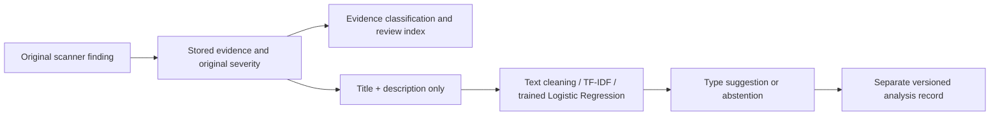

# النموذج المدرَّب في ARSTT 1.1

الموديل الأساسي: **arstt-finding-type-v1**. TF-IDF word1/2-grams + Logistic Regression، تم تدريبه محليًا على بيانات حقيقية مرخصة. ليس API خارجيًا أو rules متنكرة في صورة ML. لا يحتاج API Key عند التشغيل.

## المهمة والبيانات

يتوقع نوع المشكلة الموصوفة نصيًا ضمن9 فئات مشتقة من CWE، لمساعدة تجميع Findings. لا يتنبأ بوجود ثغرة على هدف ولم يُدرَّب على تأكيد exploitability. المدخلات summary/details بعد تنظيفها؛ CWE وseverity وCVSS ومعرفات CVE/GHSA والـURLs ليست features. عند الدمج يستخدم title + description المتاحين من نتيجة الأداة، لا شدتها أو تصنيف دليلها.

مصدر البيانات: GitHub Advisory Database ومساهموها، snapshot `d9dc212ef01743bc06ac8ffb78cc88aee8e83cb4`، https://github.com/github/advisory-database . الترخيص CC-BY-4.0، https://creativecommons.org/licenses/by/4.0/ . نسخة الترخيص مرفقة في models/DATA-LICENSE.txt. التنظيف والاشتقاق والاختيار تغييرات من ARSTT؛ لا endorsement من المصدر.

فُحص37192 سجلًا reviewed. تجربة الشدة احتفظت35729 بعد استبعاد withdrawn والنصوص القصيرة. وُجد419 سجلًا مطابقًا و741 وصلة تشابه مرتفع؛ جُمعت بمجموعات aliases/CVE وMinHash/LSH+Jaccard لمنع العبور بين الأقسام، ولم يُدَّعَ أن كل تشابه لغوي ممكن أزيل. سجلات النوع النهائية **34085** بعد استبعاد CWE المفقود والتصنيفات متعددة الفئات الملتبسة.

التقسيم المستخدم: train=23869، validation=5142، test=5074. group overlap=0. الاختيار من C=.5/2/8 حسب validation macro-F1 فقط؛ C المختار=8.0. لم تُستخدم Test لضبط معلمات نموذج النوع.

## التقييم الحقيقي

- Accuracy على Test: **87.27%**.
- Macro F1: **0.8513**، weighted F1: **0.8748**.
- Baseline most-frequent: accuracy=54.67%، macro-F1=0.0785.
- أُعيد تحميل الملف المدرَّب وإعادة حساب التقييم بشكل مستقل، وتطابقت الأرقام وconfusion matrix؛ models/evaluation-check.json.

| الفئة | Precision | Recall | F1 | Test support |
|---|---|---|---|---|
| ACCESS_CONTROL | 0.727 | 0.851 | 0.784 | 656 |
| COMMAND_INJECTION | 0.588 | 0.769 | 0.667 | 104 |
| DESERIALIZATION | 0.797 | 0.922 | 0.855 | 128 |
| MEMORY_SAFETY | 0.714 | 0.861 | 0.781 | 151 |
| OTHER | 0.924 | 0.844 | 0.882 | 2774 |
| PATH_TRAVERSAL | 0.813 | 0.908 | 0.858 | 293 |
| SQL_INJECTION | 0.933 | 0.926 | 0.929 | 121 |
| SSRF | 0.936 | 0.936 | 0.936 | 140 |
| XSS | 0.961 | 0.979 | 0.970 | 707 |


احتمال النموذج ليس ثقة مستقلة بوجود ثغرة. سياسة التشغيل تمتنع للنص الأقل من15 كلمة أو probability<.65. تغطية عتبة .65 على Test نحو83.6%، ودقة الجزء الذي لم يمتنع نحو91.8%؛ هذه أرقام مشروطة على بيانات advisories وليست ضمانًا للـscanner domain، والاحتمالات غير معايرة استقلاليًا.

## التجربة الأولى المحفوظة

تجربة تصنيف الشدة نصيًا احتُفظ بها وبمقاييسها في models/metrics.json وseverity.joblib؛ accuracy≈58.1% وmacro-F1≈.525 فقط. لذلك لا تستخدمها النسخة لتغيير شدة نتائج الأدوات. الهدف الأساسي المدمج هو تصنيف نوع المشكلة؛ لم نحذف التجربة الأضعف أو نخترع أرقامًا أفضل.

## الحدود والدمج

النصوص إنجليزية ومن advisories مراجعة، وتختلف عن banners وHTML وملخصات scanners. فئة OTHER متباينة، والـlabels قد تحمل أخطاء وعدم توازن، ولا تحل كلمات النموذج محل دليل HTTP أو exploit validation. شرح الكلمات المؤثرة هو مساهمات linear features، وليس سببًا تقنيًا مؤكدًا للثغرة.

تصنيف Confirmed/Potential/Informational مستقل من قواعد الأدلة. Confirmed في اختبار الوصول الحالي يخص عملية cross-user محددة مثبتة في Juice Shop المعزول بحسابين، لا تخمين ML. التوقعات تُحفظ منفصلة مع modelVersion وJob IDs، ويمكن إظهارها بالتقارير دون تعديل الأصل. فشل Python/model/hash/loading لا يغير نتائج الفحوصات.



## إعادة التشغيل

```bash
python3 -m venv .venv
.venv/bin/pip install -r ml/requirements.txt
.venv/bin/python ml/fetch_data.py --destination /tmp/arstt-advisory-dataset
OPENBLAS_NUM_THREADS=2 .venv/bin/python ml/train.py --data /tmp/arstt-advisory-dataset --output models
OPENBLAS_NUM_THREADS=2 .venv/bin/python ml/train_type.py --data /tmp/arstt-advisory-dataset
.venv/bin/python ml/evaluate.py --data /tmp/arstt-advisory-dataset
.venv/bin/python ml/build_advisory_index.py --data /tmp/arstt-advisory-dataset
```

يتطلب إعداد dataset اتصالًا بالشبكة وGit والمساحة المناسبة. النسخة الموزعة تشمل weights المدرَّبة والـmetrics والـsplit manifests والترخيص، ولا تحتاج إعادة التدريب لمجرد التشغيل. التنفيذ داخل Docker يستعمل Python ونسخ المكتبات المثبتة في ml/requirements.txt.
