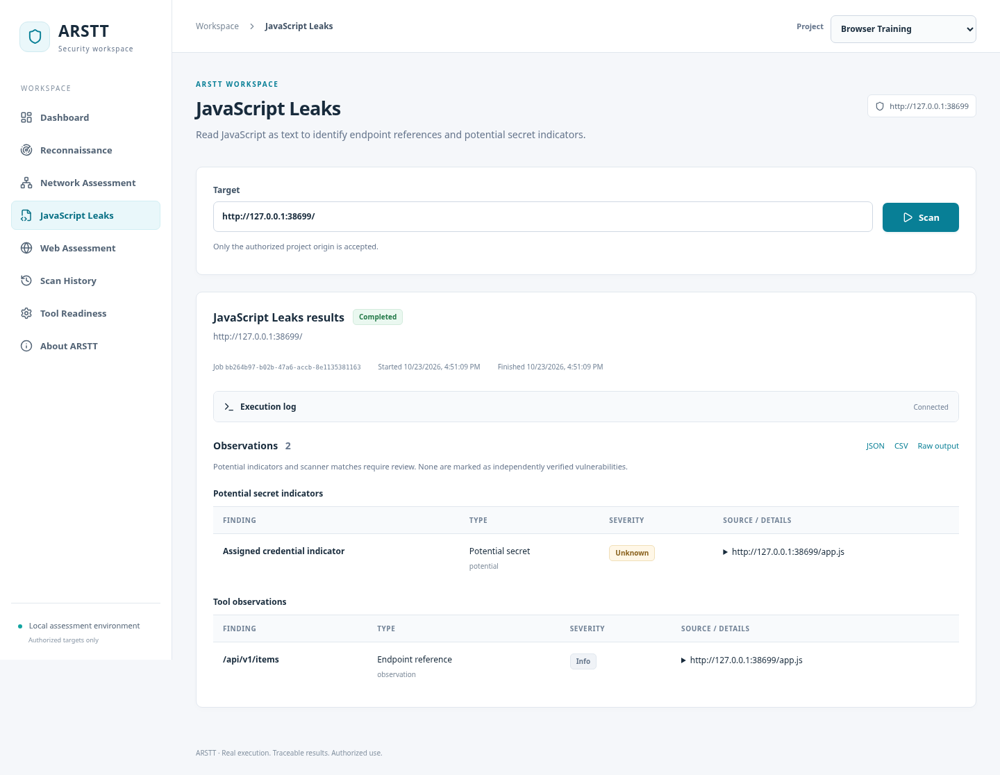

# Automated Reconnaissance and Security Testing Toolkit (ARSTT)

نسخة جديدة مستقلة مكتوبة من الصفر، وليست ملف HunterKit السابق. هذا فرع تسليم منفصل؛ لم يُستبدل main.

## التنزيل والتشغيل على Windows

1. حمّل [ARSTT-new-project.zip](https://github.com/mohamed15ahmed/ARSTT/raw/refs/heads/delivery/arstt-from-scratch/ARSTT-new-project.zip).
2. فك الملف بالكامل وافتح مجلد ARSTT.
3. شغّل Docker Desktop بوضع Linux containers وWSL2، ثم START-WINDOWS.cmd. البناء الأول يحتاج إنترنت ومساحة كافية.
4. اتبع README المرفق؛ هدف HTTP التدريبي داخل Docker هو http://lab:8088/ وTLS هو https://lab:8443/.

الواجهة والـAPI والسجل والتقارير تعمل على منفذ محلي واحد. الأدوات الفعلية مثبتة داخل صورة Docker. لا تحتاج تثبيتها على Windows يدويًا.

## التحقق

- 7 اختبارات API/SQLite/queue/process/parser ناجحة.
- مجموعتا قبول للأدوات الفعلية ناجحتان، تشملان النجاح والفشل والمهلة وعمليتي TLS منفصلتين.
- 14 فحص واجهة ناجح، بما فيها 320/390/768/1440px.
- الأدوات السبع نجحت أيضًا عبر API المنشورة ضد حاوية تدريب منفصلة.
- سُحبت التقارير وفُحصت وحُفظت السجلات بعد restart.

راجع [تقرير التحقق والحدود](VERIFICATION.ar.md) و[أدلة الاختبارات](ARSTT-new-project-evidence.zip). الاختبار الفعلي كان Docker/Linux؛ Windows/WSL2 على جهاز المستخدم لم يُختبرا هنا. AI المدرب ليس جزءًا مكتملًا من هذه النسخة، وتغطية Nuclei وZAP وRecon محددة صراحة في README داخل ZIP.

تُرفق ملفات SHA-256 للتحقق من سلامة التنزيل. لا توجد قاعدة بيانات مستخدم أو أسرار حقيقية في الحزمة. مفتاح وشهادة lab مواد تدريب عامة لا تصلح لأي خدمة حقيقية.
